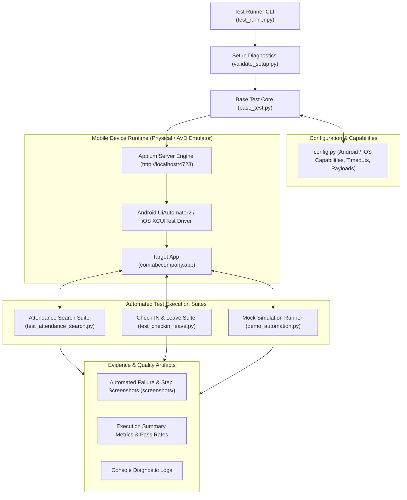

<div align="center">

<!-- Header Banner -->


<p align="center">
  
  
  
  
  
  
</p>

<p align="center">
  <a href="#-framework-overview">Overview</a> •
  <a href="#-architecture--test-execution-lifecycle">Architecture</a> •
  <a href="#-automated-test-suites">Test Suites</a> •
  <a href="#-repository-structure">Repository Structure</a> •
  <a href="#-installation--prerequisites">Setup & Installation</a> •
  <a href="#-test-execution-guide">Running Tests</a> •
  <a href="#-configuration--capabilities">Configuration</a> •
  <a href="#-author--sqa-lead">Author</a>
</p>

</div>

---

### 📖 Framework Overview

The **Enterprise Mobile SQA & Automation Suite** is an automated end-to-end testing framework engineered in **Python** using **Appium** and **UiAutomator2**. Designed to validate critical enterprise mobile business logic across human resource (HR) operations and property listing modules, the framework provides comprehensive test coverage across user authentication, dynamic attendance search, shift check-ins, and multi-step leave applications.

Built around industry-standard **Page Object Model (POM)** and separation-of-concerns paradigms, the architecture features robust element location strategies, automated screenshot evidence logging, explicit conditional synchronization, and a custom test runner providing granular execution analytics and pass/fail metrics.

---

### 🧠 Architecture & Test Execution Lifecycle



---

### 🧪 Automated Test Suites

The framework implements rigorous end-to-end automation covering high-priority mobile user journeys:

#### 1. 📅 Attendance Report Search Suite (`test_attendance_search.py`)
- **Workflow:** Authenticates the mobile session $\rightarrow$ Navigates through navigation drawer to `HR` $\rightarrow$ `My Attendance` $\rightarrow$ Selects date picker bounds ($\le 1$ month window) $\rightarrow$ Applies status filter (`On Leave`) $\rightarrow$ Executes search query.
- **Assertions:** Validates that filtered results strictly reflect the date boundary constraints, verifies that records match the "On Leave" status flag, and logs visual screenshot evidence.

#### 2. 📝 Check-IN & Leave Application Suite (`test_checkin_leave.py`)
- **Workflow:** Launches target mobile application $\rightarrow$ Traverses to `HR` $\rightarrow$ `Check-IN` $\rightarrow$ Executes location-verified check-in $\rightarrow$ Transitions to `HR` $\rightarrow$ `Leave Application` $\rightarrow$ Populates required form fields (Leave Type: *Annual Leave*, date bounds, reason text) $\rightarrow$ Submits transaction.
- **Assertions:** Verifies success toast notification, confirms modal closure, and captures confirmation screenshots for audit compliance.

#### 3. 🔍 Setup Diagnostics & Health Check (`validate_setup.py`)
- **Pre-Flight Inspection:** Automatically verifies Python environment packages (`Appium-Python-Client`, `selenium`), validates local ADB device/emulator connection, and pings the Appium HTTP server.

#### 4. 🎭 Simulation & Demo Pipeline (`demo_automation.py`)
- **Mock Runner:** Enables rapid demonstration and step-by-step UI workflow visualization without requiring a tethered physical Android device.

---

### 📦 Repository Structure

All framework components, configuration modules, and test drivers are organized directly in the root repository:

```
ABC-Company-Sqa-Assignment/
├── base_test.py               # Core Appium driver initialization, explicit waits, screenshots
├── config.py                  # Android/iOS DesiredCapabilities, timeouts & test payloads
├── test_runner.py             # CLI test runner with timing metrics & summary reports
├── test_attendance_search.py  # Automated Attendance Report Search test suite
├── test_checkin_leave.py      # Automated Check-IN & Leave Application test suite
├── validate_setup.py          # Environment diagnostics & ADB/Appium health check
├── demo_automation.py         # Mock simulation pipeline with visual step logging
├── LICENSE                    # Open-source MIT License
└── README.md                  # Comprehensive framework documentation
```

---

### ⚙️ Setup & Installation

#### Prerequisites
1. **Python 3.8+**: Ensure Python and `pip` are installed:
   ```bash
   python --version
   pip --version
   ```
2. **Node.js & Appium 2.x**:
   ```bash
   # Install Appium 2.x globally
   npm install -g appium

   # Install the official Android UiAutomator2 driver
   appium driver install uiautomator2
   ```
3. **Android SDK & ADB**: Ensure `ANDROID_HOME` is set and ADB is on your path:
   ```bash
   adb devices
   ```

#### 1. Clone the Repository
```bash
git clone https://github.com/ReaduanulFaridFahim/ABC-Company-Sqa-Assignment.git
cd ABC-Company-Sqa-Assignment
```

#### 2. Install Python Dependencies
```bash
pip install Appium-Python-Client selenium
```

#### 3. Run Pre-Flight Environment Validation
```bash
python validate_setup.py
```

---

### 🚀 Running the Tests

#### Step 1: Start Appium Server
In a dedicated terminal window:
```bash
appium
```
*Default server binds to `http://localhost:4723`.*

#### Step 2: Connect Device or Start Emulator
Ensure an active Android emulator or physical device is recognized:
```bash
adb devices
```

#### Step 3: Execute Test Suites

Execute the **full automated test suite**:
```bash
python test_runner.py
```

Execute **individual test suites** by keyword:
```bash
# Execute only the Attendance Search automation
python test_runner.py attendance

# Execute only the Check-IN & Leave Application automation
python test_runner.py checkin
```

Run **mock demonstration** (no device required):
```bash
python demo_automation.py
```

---

### 🔧 Configuration & Capabilities

Device settings, application identifiers, and operational timeouts are centralized in `config.py`:

```python
# Appium Server URL
APPIUM_SERVER_URL = "http://localhost:4723"

# Android Desired Capabilities
ANDROID_CAPABILITIES = {
    "platformName": "Android",
    "platformVersion": "11.0",           # Match your target device/emulator version
    "deviceName": "Android Emulator",
    "automationName": "UiAutomator2",
    "appPackage": "com.abccompany.app",  # Target application package
    "appActivity": "com.abccompany.app.MainActivity",
    "noReset": True,
    "fullReset": False,
    "newCommandTimeout": 300,
    "implicitWait": 10
}

# Operational Timeouts (seconds)
TIMEOUTS = {
    "implicit_wait": 10,
    "explicit_wait": 20,
    "page_load": 30
}
```

---

### 🛡️ Quality Engineering Best Practices

- **Explicit Synchronization:** Replaced brittle static sleeps (`time.sleep`) with robust dynamic `WebDriverWait` conditions (`visibility_of_element_located`, `element_to_be_clickable`).
- **Resilient Multi-Selector Fallbacks:** Uses prioritized selector fallbacks (`AppiumBy.ID` $\rightarrow$ `AppiumBy.ACCESSIBILITY_ID` $\rightarrow$ `AppiumBy.XPATH`) to maintain test stability against minor UI refactors.
- **Automatic Failure Evidence:** Intercepts test exceptions via `try-catch` blocks in `base_test.py` to capture full-resolution PNG screenshots into the `screenshots/` directory for immediate triage.
- **Resource Lifecycle Management:** Guaranteed driver `quit()` calls in teardown hooks prevent orphaned ADB sessions and memory leaks on the Appium host.

---

### 👥 Author & SQA Lead

- **Lead QA Automation Engineer:** [Readuanul Farid Fahim](https://github.com/ReaduanulFaridFahim)
- **Personal Portfolio:** [https://readuanulfaridfahim.github.io/](https://readuanulfaridfahim.github.io/)

---

<div align="center">


</div>
